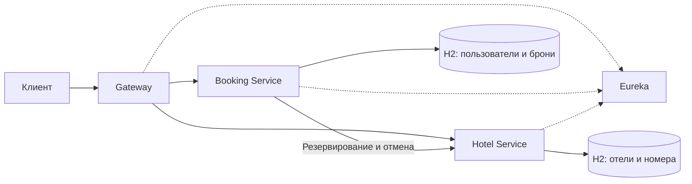

# Hotel Booking

Учебный REST API для бронирования номеров в отелях на Spring Boot. Пользователь может найти свободный номер, забронировать его и отменить бронь. Администратор управляет отелями, номерами и пользователями, а также просматривает статистику бронирований.

Проект состоит из четырёх приложений и общей библиотеки. Веб-интерфейса нет: работать с API можно через Swagger UI, Postman или curl.

**Стек:** Java 17, Spring Boot 3.5.7, Spring Cloud 2025.0.0, Spring Security, JWT, Spring Data JPA, H2, Resilience4j, OpenAPI, Maven, JUnit 5.

## Архитектура

| Модуль | Назначение | Порт |
| --- | --- | --- |
| `eureka-server` | Реестр сервисов | 8761 |
| `gateway` | Единая точка входа в API, проверка JWT и маршрутизация | 8080 |
| `booking-service` | Регистрация, вход, пользователи и бронирования | 8081 |
| `hotel-service` | Отели, номера, поиск и резервирование | 8082 |
| `common` | Общая настройка JWT, обработка ошибок и идентификаторы запросов | Нет |

Gateway находит сервисы через Eureka. Booking Service обращается к Hotel Service по HTTP, чтобы зарезервировать или освободить номер. У каждого бизнес-сервиса своя база H2. JWT проверяется в Gateway и в самих сервисах. Бизнес-сервисы также проверяют роли и принадлежность бронирований пользователю.



## Запуск

Нужны JDK 17 или новее, Bash, curl, tar, openssl и Python 3 для примеров и smoke-теста. Скрипты рассчитаны на Linux/macOS; на Windows можно использовать WSL.

```bash
git clone https://github.com/fladx/spring-hotel-booking.git
cd spring-hotel-booking
./mvnw clean verify
./scripts/start.sh
```

`mvnw` использует установленный Maven или скачивает Maven 3.9.9 с проверкой SHA-512. Для первой сборки нужен интернет. Отдельно устанавливать базу данных не нужно.

Все приложения запускаются на `localhost`. Регистрация в Eureka и обновление маршрутов Gateway могут занять 1–2 минуты. До этого запросы через Gateway могут возвращать `503`.

После запуска доступны:

- API: `http://localhost:8080/api`
- Eureka: [http://localhost:8761](http://localhost:8761)
- Состояние Gateway: [http://localhost:8080/actuator/health](http://localhost:8080/actuator/health)
- Swagger Booking Service: [http://localhost:8081/swagger-ui/index.html](http://localhost:8081/swagger-ui/index.html)
- Swagger Hotel Service: [http://localhost:8082/swagger-ui/index.html](http://localhost:8082/swagger-ui/index.html)

Скрипт запуска включает тестовых пользователей:

| Логин | Пароль | Роль |
| --- | --- | --- |
| `demo` | `user-demo-123` | `USER` |
| `admin` | `admin-demo-123` | `ADMIN` |

В каталоге уже есть два отеля и шесть номеров. Логи сохраняются в `.run/`.

Остановка всех четырёх приложений:

```bash
./scripts/stop.sh
```

## Пример работы с API

Выполняйте команды в одном терминале. Сначала войдите под тестовым пользователем:

```bash
TOKEN=$(curl -fsS http://localhost:8080/api/auth/login \
  -H 'Content-Type: application/json' \
  -d '{"username":"demo","password":"user-demo-123"}' \
  | python3 -c 'import json,sys; print(json.load(sys.stdin)["accessToken"])')
```

Получите список отелей и свободных номеров на нужные даты:

```bash
curl -fsS http://localhost:8080/api/hotels \
  -H "Authorization: Bearer $TOKEN"

curl -fsS 'http://localhost:8080/api/rooms/recommend?startDate=2030-06-10&endDate=2030-06-15' \
  -H "Authorization: Bearer $TOKEN"
```

Создайте бронь с автоматическим выбором номера в первом отеле. Даты должны быть не в прошлом, а для каждой новой брони нужен новый `requestId`.

```bash
BOOKING=$(curl -fsS http://localhost:8080/api/bookings \
  -H "Authorization: Bearer $TOKEN" \
  -H 'Content-Type: application/json' \
  -d '{"requestId":"example-booking-1","autoSelect":true,"hotelId":1,"startDate":"2030-06-10","endDate":"2030-06-15"}')
echo "$BOOKING"
BOOKING_ID=$(echo "$BOOKING" | python3 -c 'import json,sys; print(json.load(sys.stdin)["id"])')
```

При успехе ответ содержит статус `CONFIRMED` и выбранный `roomId`. Для ручного выбора укажите `"autoSelect":false` и `"roomId":1`.

Посмотрите свои брони и отмените созданную:

```bash
curl -fsS http://localhost:8080/api/bookings \
  -H "Authorization: Bearer $TOKEN"

curl -fsS -X DELETE "http://localhost:8080/api/bookings/$BOOKING_ID" \
  -H "Authorization: Bearer $TOKEN"
```

## Основные маршруты

Все маршруты ниже доступны через `http://localhost:8080`. Кроме регистрации и входа, запросам нужен заголовок `Authorization: Bearer <token>`. JWT действует один час.

| Метод | Маршрут | Назначение |
| --- | --- | --- |
| POST | `/api/auth/register`, `/api/auth/login` | Регистрация и вход |
| GET | `/api/hotels`, `/api/hotels/{id}` | Список отелей и отдельный отель |
| GET | `/api/rooms`, `/api/rooms/{id}` | Список номеров и отдельный номер |
| GET | `/api/rooms/search`, `/api/rooms/recommend` | Поиск и рекомендации |
| POST, GET | `/api/bookings` | Создание брони и список своих броней |
| GET, DELETE | `/api/bookings/{id}` | Просмотр и отмена своей брони |
| POST | `/api/hotels`, `/api/rooms` | Добавление отеля или номера, `ADMIN` |
| PUT, DELETE | `/api/hotels/{id}`, `/api/rooms/{id}` | Изменение или удаление, `ADMIN` |
| GET | `/api/hotels/statistics` | Статистика, `ADMIN` |
| GET, POST | `/api/users` | Список и создание пользователей, `ADMIN` |
| GET, PUT, DELETE | `/api/users/{id}` | Управление пользователем, `ADMIN` |

Даже администратор может читать и отменять только собственные брони.

Поиск поддерживает фильтры по отелю, городу, цене, вместимости и датам проживания. Списки используют пагинацию `page=0&size=20`, максимальный размер страницы составляет 100 записей. Форматы запросов и ответов описаны в Swagger и README отдельных сервисов.

## Как устроено бронирование

- Бронь проходит состояния `PENDING` → `CONFIRMED`. При ошибке она получает статус `CANCELLED`, а сервис пытается освободить резерв. Если сразу это не удалось, освобождение повторяется. При `ownerRetryRequired=true` владелец должен повторить отмену с новым JWT.
- Повтор запроса с тем же `requestId` и данными не создаёт вторую бронь. Изменённые данные с тем же ключом возвращают `409`. Ключи учитываются отдельно для каждого пользователя.
- Одновременные запросы не могут занять один номер на пересекающиеся даты. День выезда не входит в бронь, поэтому следующий гость может заселиться в тот же день. Допустимый срок проживания: от 1 до 365 ночей.
- Автоподбор выбирает свободный номер с наименьшим `timesBooked`, а при равенстве счётчиков выбирает меньший `id`. Отмена не уменьшает счётчик. Поле `available` показывает, доступен ли номер для эксплуатации. Занятость проверяется отдельно по датам.
- Внутренние маршруты `/internal/rooms/reserve` и `/internal/rooms/release` требуют JWT и недоступны через Gateway. Повторное освобождение безопасно; запоздавшее резервирование после отмены отклоняется.

## Тесты

```bash
./mvnw verify
./mvnw spotless:check
```

Тесты проверяют авторизацию, роли, валидацию, поиск, конкурентное бронирование, повторные запросы и отмену при сбоях Hotel Service. Отчёты сохраняются в `*/target/surefire-reports/`. Применить форматирование Java-кода можно командой `./mvnw spotless:apply`.

После запуска всех сервисов можно выполнить сквозную проверку через Gateway:

```bash
python3 scripts/smoke.py
```

## Ограничения

Проект предназначен для локального запуска и изучения микросервисов.

- H2 хранит данные в памяти и теряет их после остановки. Для повторной демонстрации перезапускайте все сервисы вместе.
- Тестовые пароли и JWT-ключ в конфигурации публичны. Перед внешним размещением нужны собственный `JWT_SECRET`, одинаковый для Gateway, Booking и Hotel, отключённые демопользователи, TLS и закрытый доступ к внутренним API. `start.sh` всегда включает демопользователей и предназначен только для локальной демонстрации.
- Блокировка выделения номера в Hotel Service общая для всех отелей. Восстановление броней рассчитано на один экземпляр Booking Service. Масштабирование потребует другой схемы координации и постоянной БД.
- Выпущенные JWT не отзываются при изменении роли или удалении пользователя и действуют до истечения срока.

## Документация

- [Booking Service: API и отмена бронирований](booking-service/README.md)
- [Hotel Service: каталог и резервирование номеров](hotel-service/README.md)
- [Архитектурные решения](docs/ADR.md)
- [Модель данных](docs/DESIGN.md)
- [Результаты проверок](docs/VERIFICATION.md)
