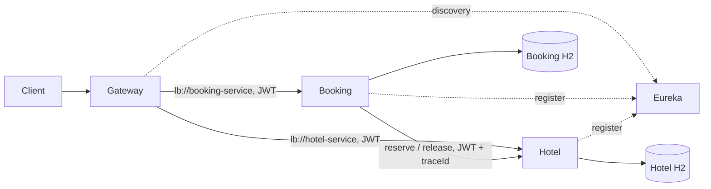

# Hotel Booking: итоговый проект Spring

REST-система бронирования отелей: четыре независимо запускаемых приложения и общая библиотека.
Java 17+, Spring Boot 3.5.7, Spring Cloud 2025.0.0, H2 in-memory, Spring Security Resource Server,
JWT, JPA/Hibernate, OpenAPI, JUnit 5. Фронтенд не нужен: API доступно через curl/Swagger.

## Сборка и запуск

Нужен **полный JDK 17+** (не только JRE), curl, tar и openssl. Для smoke-проверки нужен Python 3. `./mvnw` использует системный Maven,
а если его нет — скачивает Maven 3.9.9 с Maven Central и проверяет SHA-512.

```sh
./mvnw clean verify
./mvnw spotless:check
./scripts/start.sh
# после регистрации сервисов в Eureka
python3 scripts/smoke.py
# завершение только процессов, запущенных скриптом
./scripts/stop.sh
```

Первый запуск требует интернет для Maven-зависимостей. Запуск `start.sh` требует собранных JAR.
Все приложения по умолчанию слушают только loopback. Порты: Eureka8761, Gateway8080,
Booking8081, Hotel8082. H2 хранится в памяти **каждого** бизнес-сервиса и очищается при остановке.
Логи и PID локальных процессов находятся в `.run/`. Скрипт не меняет firewall, VPN и системные службы.

В учебном режиме используется явно публичный демонстрационный JWT_SECRET. Это **не секрет для эксплуатации**.
Для любого размещения вне локальной машины задайте собственный JWT_SECRET одинаково всем трём сервисам,
отключите демопользователей, настройте TLS, сетевую изоляцию внутренних API и секрет-хранилище.

`start.sh` включает демонстрационных пользователей: `demo / user-demo-123`, `admin / admin-demo-123`.
Эти пароли — открытые тестовые данные. Регистрировать пользователей можно через `/api/auth/register`.

## Первый сценарий

```sh
TOKEN=$(curl -fsS http://localhost:8080/api/auth/login -H 'Content-Type: application/json' \
  -d '{"username":"demo","password":"user-demo-123"}' | python3 -c 'import json,sys;print(json.load(sys.stdin)["accessToken"])')
curl -fsS http://localhost:8080/api/hotels -H "Authorization: Bearer $TOKEN"
curl -fsS 'http://localhost:8080/api/rooms/recommend?startDate=2030-06-10&endDate=2030-06-15' \
  -H "Authorization: Bearer $TOKEN"
curl -fsS http://localhost:8080/api/bookings -H "Authorization: Bearer $TOKEN" \
  -H 'Content-Type: application/json' -H 'X-Request-Id: demo-trace-1' \
  -d '{"requestId":"example-booking-1","autoSelect":true,"hotelId":1,"startDate":"2030-06-10","endDate":"2030-06-15"}'
curl -fsS http://localhost:8080/api/bookings -H "Authorization: Bearer $TOKEN"
# подставить id из ответа
curl -fsS -X DELETE http://localhost:8080/api/bookings/1 -H "Authorization: Bearer $TOKEN"
```

После старта дождитесь регистрации и обновления discovery-кэша Eureka/Gateway (обычно до 1–2 минут при одновременном холодном старте). В это время Gateway может отвечать 503. Проверка сервисов:
`http://localhost:8761/`, `http://localhost:8080/actuator/health`.
OpenAPI сервисов: `http://localhost:8081/swagger-ui.html`, `http://localhost:8082/swagger-ui.html`.
API защищено bearer JWT; UI документации доступен локально без JWT для удобства просмотра.

## Архитектура



- [Booking API и восстановление компенсации](booking-service/README.md)
- [Hotel API и конкурентное резервирование](hotel-service/README.md)
- [Архитектурные решения](docs/ADR.md)
- [Схема данных и критерии](docs/DESIGN.md)

Gateway маршрутизирует только `/api/auth/**`, `/api/users/**`, `/api/bookings/**`, `/api/hotels/**`,
`/api/rooms/**`. `/internal/**` запрещён и **не имеет маршрута**. Бизнес-сервисы независимо проверяют
подпись, срок и issuer JWT. Авторизация ролей и владельца выполняется в самих сервисах.

Условие содержит примерную, местами неоднозначную структуру URL. В проекте выбрана единая схема
`/api/...`; внутренние подтверждение/освобождение вынесены в `/internal/rooms/reserve|release`,
чтобы широкий публичный маршрут `/api/rooms/**` не открыл компенсацию наружу.

## Гарантии и границы

Booking коммитит PENDING **до** HTTP-запроса в Hotel. Успех → CONFIRMED.
Ошибка → CANCELLED и зафиксированная необходимость компенсации. Компенсация идемпотентна.
Если release приходит раньше запоздавшего reserve, tombstone запрещает последующую блокировку.
При неопределённом ответе повтор использует тот же requestId. Идемпотентность ограничена владельцем.
Изменение смыслового тела запроса с тем же ключом →409.

Hotel использует DB-lock для атомарного выбора и проверки пересечений. Интервалы полуоткрытые
`[startDate,endDate)`: выезд одного клиента может совпадать с заездом другого. `available` означает
эксплуатационную доступность, а не занятость. `timesBooked` считает успешные выделения за всё время,
отмена не уменьшает счётчик; повтор не увеличивает. Автоподбор сортирует по счётчику и затем id.

Это учебная система, не готовый продакшен: in-memory H2 не переживает рестарт, один глобальный
allocation-lock ограничивает throughput, общий симметричный ключ позволяет его обладателю выпускать JWT.
Для production нужны долговечная БД/миграции, партиционированные блокировки, асимметричные ключи,
service-to-service identity, гарантированная доставка компенсаций и внешнее наблюдение.

## Проверки

`./mvnw verify` выполняет настоящие H2/HTTP-интеграционные тесты: конкуренция, совпадение ключей,
компенсация после тайм-аута, повторная доставка, недоступность Hotel, роли, владение бронью,
истёкший JWT, валидация. `./mvnw spotless:apply` применяет единое форматирование Google Java Format.
Тестовые отчёты: `*/target/surefire-reports`. Подробный фактический результат текущего прогона
см. `docs/VERIFICATION.md`; наличие теста в исходниках не означает, что он прошёл.

## Сдача

В Skillfactory сдаётся ссылка на GitHub-репозиторий с исходниками, README и документацией.
Этот каталог подготовлен локально в облачной рабочей среде: публикация и отправка на платформу
не производились. Не включайте `.run`, `.tools`, `target`, `.env` и собственные ключи в репозиторий.

## Версии и официальные источники
- [Матрица совместимости Spring Cloud](https://spring.io/projects/spring-cloud/): train2025.0.x соответствует Boot3.5.x.
- [Spring Boot 3.5 requirements](https://docs.spring.io/spring-boot/3.5/system-requirements.html): Java17+.
- [JWT Resource Server](https://docs.spring.io/spring-security/reference/servlet/oauth2/resource-server/jwt.html).
- [Maven](https://maven.apache.org/).
