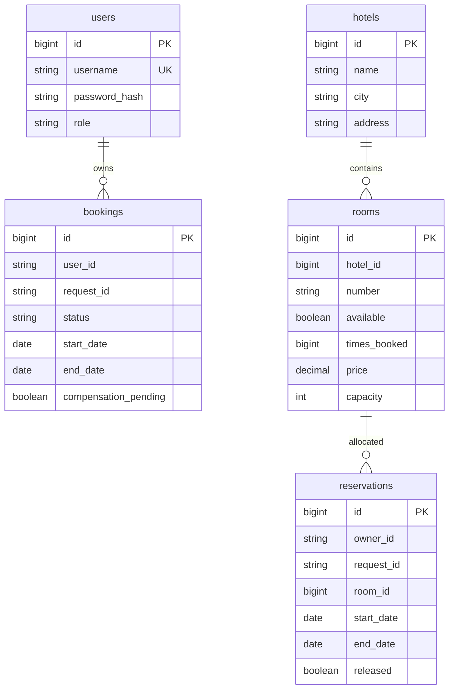

# Модель данных и покрытие критериев

Базы изолированы: Booking users/bookings, Hotel hotels/rooms/reservations/allocation lock.
Межсервисные roomId/userId — идентификаторы, не JPA-связи между БД. Hotel.room → Hotel.hotel — FK.
Reservation ledger уникален по ownerId/requestId; Booking уникальна по userId/requestId;
username уникален, room number уникален внутри отеля. Даты и operational flag проверяются до reserve.

## Проверяемые сценарии
- Успех с ручным и автоматическим выбором.
- Одинаковый ключ и тот же запрос не создаёт вторую бронь; изменённое тело отклоняется.
- Разные пользователи могут иметь одинаковый requestId, не влияя друг на друга.
- Одновременное пересечение интервалов: только один победитель; соседние интервалы допустимы.
- Ошибка Hotel, транспортный тайм-аут после выделения, ранняя компенсация/позднее подтверждение.
- Неуспешная компенсация остаётся видимой и восстанавливается с новым JWT владельца.
- 401 без JWT/при истечении; 403 при недостаточной роли; чужая бронь скрыта как404.

## Рубрика (50 баллов)
Планирование5: Hotel allocation ledger/locks/idempotency/autoSelect.
Согласованность5: Booking saga/compensation/retry/timeout/circuit breaker.
Booking5: ownership, pagination, validation, idempotency.
Hotel5: CRUD, фильтры, сортировка, статистика.
Gateway/Eureka5: discovery routes, JWT protection, X-Request-Id correlation.
Security5: resource server в каждом сервисе, роли, @PreAuthorize,401/403.
Integration tests3; DB schema2; demo data2; code quality3; formatter2;
ErrorDTO2; structured log events2; README/architecture/ADR2; readable independent tests2.

Это карта реализации, не гарантия оценки преподавателем. Точный результат прогонов фиксируется отдельно.

Связь reservations.room_id может отсутствовать у release-tombstone: компенсация могла прийти раньше
reserve. Идентификатор комнаты у поздней команды не должен быть назначен после такого tombstone.
